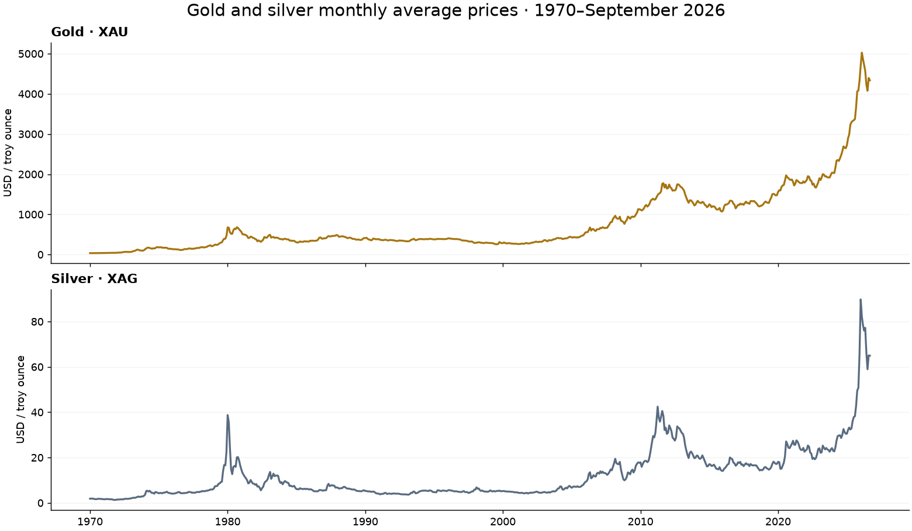

# Gold & Silver Monthly Prices | 1970–2026

**[AlyawmGold dataset page](https://alyawmgold.com/gold-silver-price-dataset)** — overview, chart, and direct JSON download.

**681 consecutive months · two precious metals · USD per troy ounce · JSON**

Explore more than 56 years of gold and silver monthly price history in one compact file. This snapshot covers **January 1970 through September 2026**, with one row per month and a source-reported monthly average for each metal.

Prepared by **[AlyawmGold](https://alyawmgold.com/)**. The archived reference release is available on **[Zenodo, DOI: 10.5281/zenodo.23738959](https://doi.org/10.5281/zenodo.23738959)**.



## At a glance

| Attribute | Value |
| --- | --- |
| Coverage | January 1970–September 2026, inclusive |
| Frequency | Monthly; completed UTC calendar months |
| Observations | 681 rows; 1,362 metal-price values |
| Metals | Gold (XAU) and silver (XAG) |
| Currency and unit | Nominal USD per troy ounce |
| Missing months | None within the stated coverage |
| License | CC BY 4.0 |
| Source snapshot | October 28, 2026 |

## Files and fields

- **monthly-gold-silver.json:** the exact data file archived on Zenodo. Metadata describes its sources, units, retrieval timestamps, license, and coverage; observations are in the top-level `data` array.
- **README.md:** this field guide, preparation notes, limitations, and citation.
- **CITATION.cff:** machine-readable citation for the archived dataset.
- **LICENSE:** the official CC BY 4.0 license text.
- **price-history.png:** a chart of the two source-reported monthly price series.
- **explore-gold-silver.ipynb:** an executed Python example that loads the JSON, checks coverage, plots both price series, and explores the ratio of monthly averages and percentage changes in monthly average prices.

| Field | Meaning |
| --- | --- |
| `month` | UTC calendar month in `YYYY-MM` format |
| `gold_average_usd_per_ounce` | Source-reported monthly average gold price, USD per troy ounce |
| `silver_average_usd_per_ounce` | Source-reported monthly average silver price, USD per troy ounce |

## Quick start

Download [monthly-gold-silver.json](monthly-gold-silver.json) or clone this repository. The `data` array contains the 681 monthly observations; the surrounding metadata records sources, units, coverage, and license information.

```python
import json
from pathlib import Path
import pandas as pd

metadata = json.loads(Path("monthly-gold-silver.json").read_text(encoding="utf-8"))
prices = pd.DataFrame(metadata["data"])
prices["month"] = pd.to_datetime(prices["month"], format="%Y-%m")
prices = prices.set_index("month")
print(prices.tail())
```

Open [explore-gold-silver.ipynb](explore-gold-silver.ipynb) for an executed example with charts, coverage checks, the ratio of monthly averages, and changes in average price levels. It uses Python, pandas, and Matplotlib and reads the local JSON without API keys or network access.

To use the Hugging Face mirror:

```python
from datasets import load_dataset

prices = load_dataset(
    "khaledAlhelwane/gold-silver-monthly-prices-1970-2026",
    split="train",
)
```

The mirror's `train` split contains the full snapshot, not a predefined forecasting training set. Create chronological training and evaluation windows for your analysis.

## How it was prepared

Gold API is the primary source of the historical gold and silver price data. AlyawmGold prepares, organizes, and publishes this monthly dataset. Source URLs and retrieval timestamps are recorded in the JSON.

The source-reported monthly averages were preserved. No missing months were interpolated, no exchange-rate conversion was applied, and averages were not recomputed from the previously flagged daily history. October 2026 is excluded because it was unfinished at collection time.

## Quality checks and known limitations

Checks verify JSON structure, 681 ordered and unique consecutive months, positive finite numeric prices, and agreement of the exported prices with collected source responses. Matching the source does not independently establish that all upstream observations are accurate or that the averaging method is identical across the entire history.

A comparison with World Bank monthly reference prices flagged differences exceeding 5% for **gold in December 1980 and July 1983**, and **silver in December 2025**. The original values are retained. These are unresolved comparison differences, not confirmed errors; the comparison reference did not replace source data.

Prices are monthly averages rather than month-end closing prices, intraday quotes, local dealer prices, or inflation-adjusted prices. Displayed decimal precision is not a measure of accuracy. Changes between monthly averages should not be interpreted as executable investment returns. Use chronological train/test splits for any forecasting experiment and retain the quality caveats in your analysis.

## Suggested uses

- Visualize long-run precious-metal price trends.
- Compare gold and silver monthly average prices over the same periods.
- Study changes in average price levels and the ratio of gold to silver monthly averages.
- Practice time-series exploration using a documented historical snapshot.

## Sources, license, and citation

Primary price-data source: **[Gold API](https://gold-api.com/)**. Dataset preparation and publication: **[AlyawmGold](https://alyawmgold.com/)**. **[World Bank Commodity Markets](https://www.worldbank.org/en/research/commodity-markets)** was used only as a comparison reference.

The [LICENSE](LICENSE) file contains the **[Creative Commons Attribution 4.0 International](https://creativecommons.org/licenses/by/4.0/)** terms. This license applies to the extent of rights held by the licensor. Credit AlyawmGold, link to the license, indicate changes, and retain source acknowledgments. The license does not grant additional rights in third-party material.

> AlyawmGold. (2026). Monthly Gold and Silver Prices in USD per Troy Ounce (1970–2026) — AlyawmGold (Version 1.0.0) [Data set]. Zenodo. https://doi.org/10.5281/zenodo.23738959

## Other access points

- **[Zenodo archived release and DOI](https://doi.org/10.5281/zenodo.23738959)**
- **[Kaggle](https://www.kaggle.com/datasets/khaledalhelwane/gold-and-silver-monthly-prices-19702026)**
- **[Hugging Face dataset and table preview](https://huggingface.co/datasets/khaledAlhelwane/gold-silver-monthly-prices-1970-2026)**
- **[AlyawmGold website](https://alyawmgold.com/)**

**Update status:** Version 1.0.0 is a fixed historical snapshot. No automatic daily or hourly update feed is promised. Future completed-month snapshots should be released as new versions.
